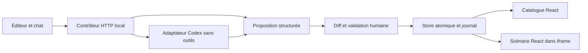

# Architecture V2

## Choix

TypeScript côté client et serveur, React pour le partage exact des composants,
Vite pour compiler et développer, HTTP Node standard pour un backend léger, Zod
pour les frontières JSON. Pas d’Electron : l’application reste accessible dans un
navigateur et la maintenance est plus simple pour les trois OS. `tsx` lance le
backend typé ; les dépendances de développement sont donc nécessaires à l’usage.
`npm ci --omit=dev` n’est pas un mode d’installation supporté.

## Modules et frontières

| Module                        | Responsabilité                                              |
| ----------------------------- | ----------------------------------------------------------- |
| `app/shared/model.ts`         | Types, schémas, diff, calcul de contraste, variables CSS    |
| `app/server/files.ts`         | Lecture bornée sans lien, écriture privée atomique partagée |
| `app/shared/project.ts`       | Contrat strict du brief PFE privé                           |
| `app/server/project.ts`       | Brief privé, empreinte et conflits multi-onglets            |
| `app/client/ProjectBrief.tsx` | Édition et export du contexte, sans dépendance IA           |
| `app/client/useTokenDraft.ts` | Brouillon facultatif par onglet, jamais une validation      |
| `app/server/store.ts`         | État, propositions bornées en mémoire, journal et conflits  |
| `app/server/http.ts`          | Origine, session locale, validation HTTP et routage fermé   |
| `app/server/index.ts`         | Configuration locale, verrou d’instance, cycle de vie       |
| `scripts/runtime.mjs`         | Identité privée, verrou récupérable et arrêt authentifié    |
| `scripts/launcher.mjs`        | Panneau local sans dépendance, préparation npm confirmée    |
| `launcher/` et entrées OS     | Interface légère, découverte Node et guide hors ligne       |
| `app/client/App.tsx`          | Orchestration des trois panneaux, diff et historique        |
| `app/client/DesignSystem.tsx` | Composants et scénarios partagés, interactions natives      |
| `connectors/agents`           | Fournisseurs indépendants, résultat normalisé sans mutation |
| `connectors/figma`            | OAuth et REST Figma en lecture seule, stockage privé         |

Le backend n’accepte jamais un chemin, une commande, une URL MCP ou un outil envoyé
par le navigateur. Il n’écrit que les fichiers de tokens et de brief explicitement connus. Les scripts exécutés par
l’étudiant pour développer ont naturellement d’autres droits : cette séparation
n’est pas un bac à sable du système entier.

La connexion Figma suit la même frontière : le client envoie un lien, des noms de
tokens et des noms de variantes. Le serveur vérifie l’état OAuth, lit Figma avec
ses propres jetons privés et renvoie uniquement un statut, des métadonnées et des
changements. Aucune route n’écrit vers Figma.

## Flux de modification

1. Le client envoie `{revision, changes:[{key,value}]}` à `/api/proposals`.
2. Le store valide noms, types, doublons et révision ; calcule le diff sur l’état courant.
3. Il retourne un identifiant imprévisible et le diff. Aucun fichier ne change.
4. L’utilisateur accepte via `/api/commit` avec cet identifiant. On ne peut pas remplacer
   les valeurs d’une proposition lors du commit : elles viennent du store serveur.
5. La copie précédente complète est écrite avant le remplacement de l’état courant.
   La file sérielle vérifie la révision et l’empreinte du fichier. Le nouvel état et
   son journal sont écrits ensemble dans un fichier temporaire, fsync puis rename.
6. Après réussite disque uniquement, l’interface reçoit l’état. BroadcastChannel et
   une relecture périodique synchronisent les vues et les onglets locaux.

L’iframe charge le même bundle et les mêmes composants ; sa largeur définit un
vrai viewport de 320/375/430/1024 px. Les media queries s’y appliquent réellement.
Le desktop n’est pas une image mobile agrandie et aucun scale CSS n’est utilisé.

## Stockage et restauration

`.ds-studio/state.json` contient `version`, `revision`, `tokens`, `history`.
L’historique est un journal de patchs `{key,before,after}`, source et date. Une
annulation inverse seulement les tokens touchés si leurs valeurs correspondent
encore au patch original. Elle refuse le conflit au lieu de perdre un changement
ultérieur. Elle ajoute une révision ; les autres données et le journal demeurent.

Une instance serveur par dossier via verrou exclusif. Un fichier illisible ou un
historique incohérent bloque le démarrage sans remise à zéro. Les propositions
vivent en mémoire (100 maximum), expirent par éviction ou redémarrage et ne sont
pas acceptées automatiquement. Le journal a une limite de 10 Mo : dépassement
refusé, pas de troncature. Pas de base multiprocessus ni collaboration distante.

Le seed n’est pas un miroir du journal. Les changements du seed ne remplacent jamais
un état existant. Import/export servent aux palettes et au versioning volontaire.

## Routes utiles

GET : `/api/bootstrap`, `/api/state`, `/api/export`, `/api/project`, `/api/agents`,
`/api/figma/status`, et le callback OAuth `/api/figma/oauth/callback`.
Le bootstrap ne lance aucun CLI : la détection IA est demandée séparément,
uniquement après sélection d’un mode IA.
POST : `/api/project`, `/api/proposals`, `/api/commit`, `/api/undo`, `/api/import`, `/api/agent`,
`/api/figma/oauth/start`, `/api/figma/file`, `/api/figma/changes`, `/api/figma/disconnect`.
Les POST exigent JSON et la capacité de session reçue depuis le bootstrap same-origin.
Toutes les autres routes API échouent, notamment commandes libres et toute écriture
distante Figma.

Les routes privées `/_studio/health` et `/_studio/stop` exigent une capacité
distincte, connue seulement du propriétaire du dossier et de son lanceur.
Le contrôleur écoute sur une autre socket locale avec sa propre capacité ;
ses seules actions sont start/open/stop/restart/prepare/restore/quit. Il ne change pas
le contrat des tokens ni le périmètre du chat. Voir [LAUNCHER](LAUNCHER.md).

## Limites évolutives

Le polling est un raccourci suffisant pour un projet local ; remplacer par SSE si
la charge ou les vues augmentent. Les clés de tokens sont explicites pour rendre
l’impact lisible ; ajouter une catégorie exige de modifier schéma, seed, mappings
et tests. Pas de moteur de rendu de composants arbitraires ou de CSS non fiable.

## Reprise et erreurs V2

`state.previous.json` est le fichier courant complet avant le dernier commit.
La restauration s’exécute sous le même bail exclusif que le serveur, atelier arrêté,
après confirmation. Elle valide schéma et journal, archive l’original (même invalide),
puis remplace atomiquement le courant. Elle ne restaure ni brief ni conversations.
Les archives de réparation restent privées ; pas de suppression automatique.

Le serveur lancé depuis le panneau est détaché et écrit dans un fichier privé,
pas dans des pipes détenus par le panneau. Le panneau suivant retrouve son identité
par contrôle HTTP authentifié, pas par signal aveugle. Le journal serveur est
tronqué au démarrage et sa lecture d’affichage est bornée à 10 Ko.

Le client réessaie une seule fois un POST refusé explicitement pour capacité de
session manquante, après nouveau bootstrap. Il ne réessaie jamais une erreur réseau
ou un commit inconnu : son effet pourrait déjà avoir eu lieu. Les propositions
expirent au redémarrage ; refaire le diff. Le polling ne se chevauche pas et ne
remplace pas une révision affichée par une réponse plus ancienne ; après une
restauration volontaire vers une révision inférieure, recharger les onglets.
Le brouillon utilise sessionStorage avec repli mémoire si le navigateur le refuse ;
ce n’est pas une sauvegarde garantie après fermeture du navigateur.

Le brief possède une empreinte indépendante des tokens. Le sauver ne crée pas une
révision DS. Deux éditions du même brief ne peuvent pas s’écraser silencieusement.
Le chat Codex ajoute le brief privé au contexte explicitement indiqué dans l’UI.
